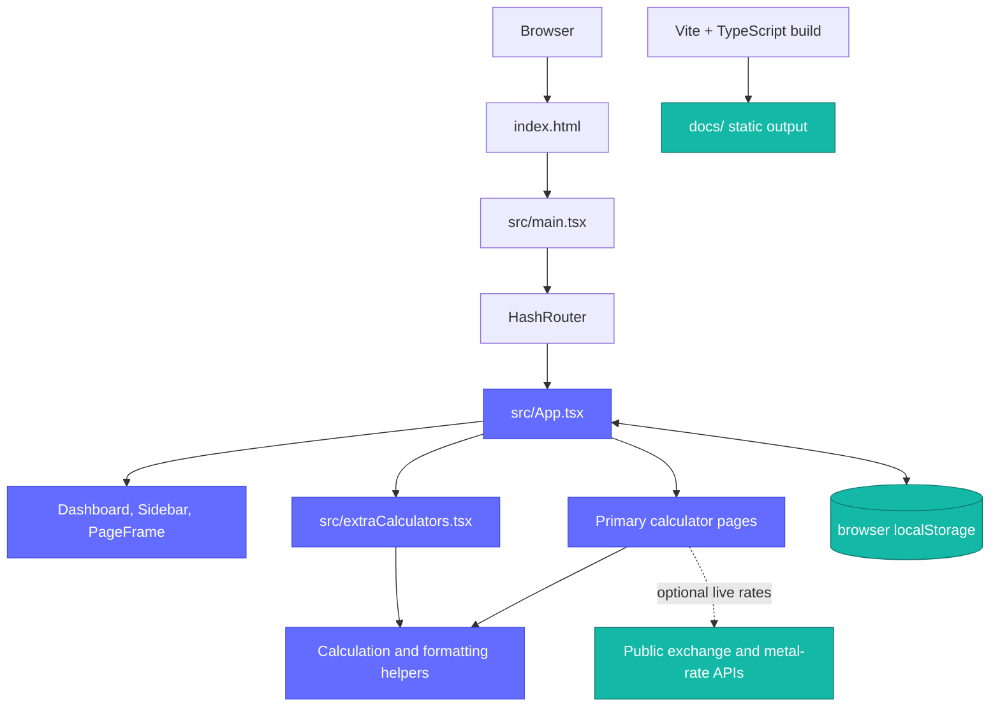

# Calculators Dashboard

<div align="center">

**A lively, India-friendly collection of everyday calculators — fast, local, and pleasantly un-fussy.**

<!-- TODO: Replace with a banner, logo, or short product demo GIF. -->


[](./package.json)
[](#-license)
[](https://react.dev/)
[](https://www.typescriptlang.org/)
[](https://vite.dev/)
[](https://github.com/prashantgabu-e/calculators/commits/master)
[](#-contributing)

</div>

## ✨ Why this exists

Quick calculations should not need a spreadsheet, an account, or a maze of ads.
Calculators Dashboard puts useful finance, tax, shopping, health, and daily-life tools in one responsive browser app, with Indian currency formatting where it matters.

## 🧭 Table of contents

- [Features](#-features)
- [Demo and screenshots](#-demo-and-screenshots)
- [Architecture](#-architecture)
- [Tech stack](#-tech-stack)
- [Project structure](#-project-structure)
- [Quick start](#-quick-start)
- [Usage](#-usage)
- [Key modules](#-key-modules)
- [Deployment](#-deployment)
- [Testing and quality checks](#-testing-and-quality-checks)
- [Roadmap](#-roadmap)
- [Contributing](#-contributing)
- [Troubleshooting](#-troubleshooting)
- [License](#-license)

## 🚀 Features

- 🔎 **Search without spelunking** — filter the full calculator catalogue from the All Calculators page.
- ⭐ **Browser-local favourites** — star the tools you use most; they stay at the top after a refresh on the same browser.
- 💸 **India-friendly money tools** — use rupee formatting across calculators such as EMI, SIP, GST, income tax, and fuel cost.
- ⛽ **Fuel cost *and* mileage** — estimate trip/monthly fuel spend or calculate vehicle efficiency in km/L.
- 🛒 **Pack-price comparisons** — find per-item, per-unit, per-litre, or per-kilogram prices with the Unit Price Calculator.
- 🌗 **Theme-aware and responsive** — light/dark themes, an adaptive sidebar, and numeric-friendly mobile inputs.
- 📦 **Static by design** — calculations run in the browser; no account, database, or application server is required.
- 📡 **Graceful live-rate fallbacks** — currency and precious-metal tools can use public live rates and retain built-in fallback values if unavailable.

## 🖼️ Demo and screenshots

<!-- TODO: Replace these placeholders with committed screenshots or a demo GIF. -->


*Placeholder: calculator search, favourite star, and grouped navigation.*


*Placeholder: Fuel Cost and Mileage Calculator modes.*

## 🏗️ Architecture



`src/main.tsx` mounts the React app in a `HashRouter` and registers the service worker. `App.tsx` owns the route catalogue, dashboard, shared UI primitives, primary calculator pages, preferences, favourites, and supporting helpers. Additional calculator pages live in `src/extraCalculators.tsx`. Results are derived from component state in the browser; only optional rate lookups leave the app.

## 🧰 Tech stack

| Layer | Tech | Why |
| --- | --- | --- |
| UI | React 19 | Component-based calculator pages and local input state |
| Language | TypeScript 5.9 | Safer calculator logic and route/component contracts |
| Routing | React Router 7 + `HashRouter` | Static-hosting-friendly client-side routes |
| Build | Vite 7 | Fast local development and static production bundles |
| Styling | Plain CSS | Lightweight responsive layout and theme variables |
| Icons | Lucide React | Consistent navigation and calculator iconography |
| Persistence | Browser `localStorage` | Stores theme, sidebar preference, and favourites locally |
| Static assets | Service worker + web manifest | Supports installable/offline-friendly static delivery |

## 🗂️ Project structure

```text
calculators/
├── public/                  # Static assets, icons, manifest, and service worker
├── src/
│   ├── App.tsx              # App shell, routes, shared controls, and main calculators
│   ├── extraCalculators.tsx # Additional calculators, including Fuel Cost & Mileage
│   ├── main.tsx             # React mount point, HashRouter, service-worker registration
│   ├── styles.css           # Theme, responsive layout, cards, navigation, and forms
│   └── types/               # Local TypeScript declaration files
├── documents/               # Supporting feature and architecture notes
├── docs/                    # Generated Vite production output for static hosting
├── build-and-push.ps1       # Windows build, commit, and push helper
├── package.json             # npm scripts and package manifest
└── vite.config.ts           # Vite base path and docs/ build output configuration
```

> [!IMPORTANT]
> `docs/` is generated output. Change source files under `src/` and then run the production build to refresh it.

## ⚡ Quick start

### Prerequisites

- Node.js 20 or newer
- npm
- Git

### Clone

```bash
git clone https://github.com/prashantgabu-e/calculators.git
cd calculators
```

### Install dependencies

```bash
npm install
```

### Environment setup

No environment file or secret is required for the current application.

| Variable | Description | Required |
| --- | --- | --- |
| — | No environment variables are currently read by the app. | No |

### Run locally

```bash
npm run dev
```

Open the URL printed by Vite, typically `http://localhost:5173`.

### Create a production build

```bash
npm run build
```

> [!TIP]
> Use `npm run preview` after building to inspect the production bundle locally.

## 🧪 Usage

This is a browser UI, so there are no HTTP endpoints or CLI calculation commands. A few real input flows:

### Compare a pack price

1. Open **Unit Price Calculator**.
2. Enter `4` items, `100` quantity per item, and `350` total price.
3. Select `ml`.
4. Read the per-item, per-ml, and per-litre comparison results.

### Calculate vehicle mileage

1. Open **Fuel Cost Calculator** and choose **Mileage**.
2. Enter `450` km travelled and `30` L used.
3. The result is `15 km/L`; add a fuel price to see trip cost and cost per km.

### Open a calculator directly

The app uses hash routing. For example, after the deployed base URL:

```text
#/fuel-cost-calculator
```

### Persist a favourite

Use the star on a calculator card. The app writes its route slug to the browser’s `calcverse-favorites` local-storage key and promotes the card in the dashboard/sidebar.

## 📚 Key modules

<details>
<summary><strong><code>src/App.tsx</code> — application shell and primary calculators</strong></summary>

- Defines `calculatorRoutes`, the single registry powering dashboard cards, navigation, and routes.
- Provides theme, sidebar, search, and favourite handling.
- Contains reusable form controls, result cards, number formatting, and many calculator pages.
- Fetches optional public exchange-rate and metal-rate data with fallback handling.

</details>

<details>
<summary><strong><code>src/extraCalculators.tsx</code> — extended calculator pages</strong></summary>

- Contains Income Tax, Salary, Lumpsum, PPF/EPF, Card EMI, Rent vs Buy, Inflation, Fuel Cost & Mileage, and other pages.
- Uses local React state and synchronous formulas; no app backend is involved.

</details>

<details>
<summary><strong><code>src/styles.css</code> — visual system</strong></summary>

- Defines light/dark CSS variables, responsive breakpoints, navigation, searchable dashboard cards, and calculator form/result layouts.

</details>

<details>
<summary><strong><code>vite.config.ts</code> — build destination</strong></summary>

- Builds to `docs/`.
- Uses `/calculators/` as the production base path and `/` during development.

</details>

## 🚢 Deployment

The project produces a static site in `docs/`, suitable for GitHub Pages or another static host.

### Static-hosting checklist

1. Build the app.

   ```bash
   npm run build
   ```

2. Confirm that `docs/index.html` and its generated `docs/assets/` files changed.
3. Commit the source changes and generated `docs/` output.
4. Configure the chosen static host to serve the `docs/` directory from the intended branch.
5. Ensure the app is hosted under `/calculators/`, or update `base` in `vite.config.ts` to match the final path.
6. Open a hash route such as `#/unit-price-calculator` after deployment.

For the repository’s Windows helper:

```powershell
.\build-and-push.ps1
```

> [!WARNING]
> The helper stages **all** working-tree changes, commits them, and pushes `origin master`. Review `git status` before using it.

> [!NOTE]
> `package.json` also contains `npm run deploy`, but it targets `dist/` while Vite is configured to build to `docs/`. Treat that script as a TODO until its target is aligned with `vite.config.ts`.

## ✅ Testing and quality checks

There is no dedicated test or lint script in the current `package.json`. The production build performs TypeScript project builds before bundling:

```bash
npm run build
```

Suggested manual checks:

- Search and star/unstar calculators, then refresh the page.
- Check positive, zero, blank, and invalid inputs for any calculator you edit.
- Check both desktop and narrow mobile layouts.
- Verify Fuel Cost and Mileage modes independently.
- Verify hash-route navigation after a production build.

## 🛣️ Roadmap

- [x] Search the calculator catalogue.
- [x] Persist starred calculators in local browser storage.
- [x] Add India-style vehicle mileage calculation in km/L.
- [x] Add unit-price comparisons for packs and UOMs.
- [ ] Add automated unit tests for formulas and formatting helpers.
- [ ] Add CI to run the build on pull requests.
- [ ] Add real screenshots or a short demo GIF.
- [ ] Add a repository license file and update the badge.
- [ ] Resolve the `deploy` script output-directory mismatch.

## 🤝 Contributing

Contributions are welcome. Keep changes focused, follow the existing TypeScript and CSS style, and build before opening a pull request.

1. Create a branch such as `feat/unit-price-history` or `fix/mileage-zero-input`.
2. Make the change and run the build.

   ```bash
   npm run build
   ```

3. Use concise conventional-style commit messages, for example:

   ```text
   feat: add calculator search
   fix: prevent zero-mileage division
   docs: clarify static deployment
   ```

4. Describe what changed, how you verified it, and any UI screenshots in the pull request.

## 🧯 Troubleshooting

<details>
<summary><strong>The deployed app has broken asset paths. What should I check?</strong></summary>

The production base path is `/calculators/`. If hosting uses another path, update `base` in `vite.config.ts`, rebuild, and redeploy `docs/`.

</details>

<details>
<summary><strong>Why did a favourite disappear?</strong></summary>

Favourites live in the current browser’s local storage under `calcverse-favorites`. Clearing site data, using another browser/device, or private browsing can remove them.

</details>

<details>
<summary><strong>Why does a live rate show an offline/fallback value?</strong></summary>

The currency and metal calculators fall back when a public rate request is unavailable or invalid. Check the displayed source/status and your network connection.

</details>

<details>
<summary><strong>Why does <code>npm run deploy</code> not publish the built site?</strong></summary>

Vite builds into `docs/`, while the current deploy script references `dist/`. Use the static-hosting workflow above or update the script as part of the roadmap item.

</details>

## 📄 License

**TODO:** This repository does not currently include a license file. Add one before treating the project as open-source or accepting external contributions under defined terms.

## 🙌 Credits

Built with React, TypeScript, Vite, React Router, Lucide, and `money`.

Made for quick answers, fewer tabs, and a little more “nice, done.” ✨
